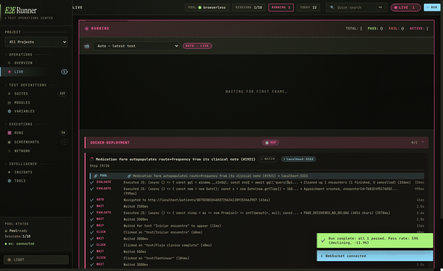
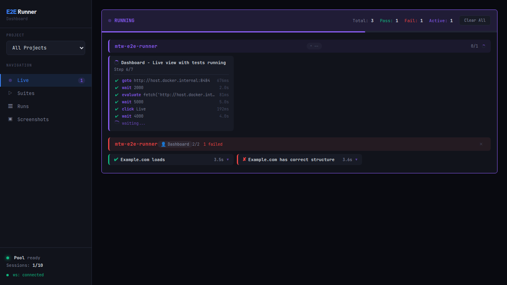
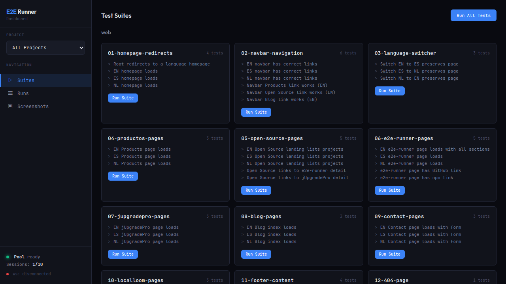
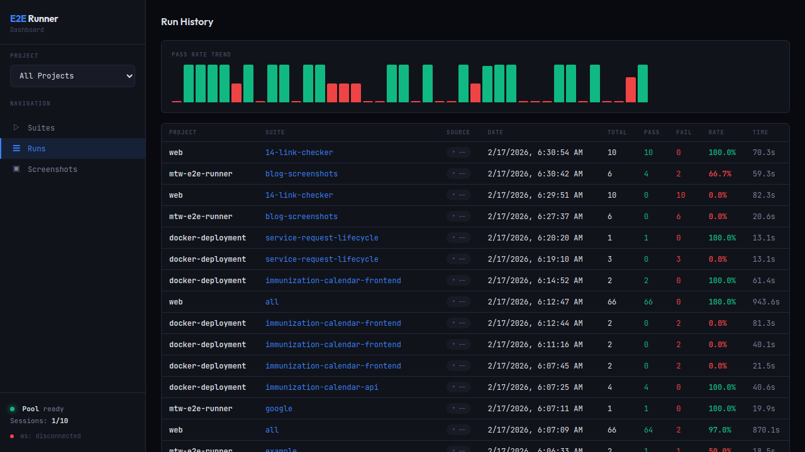
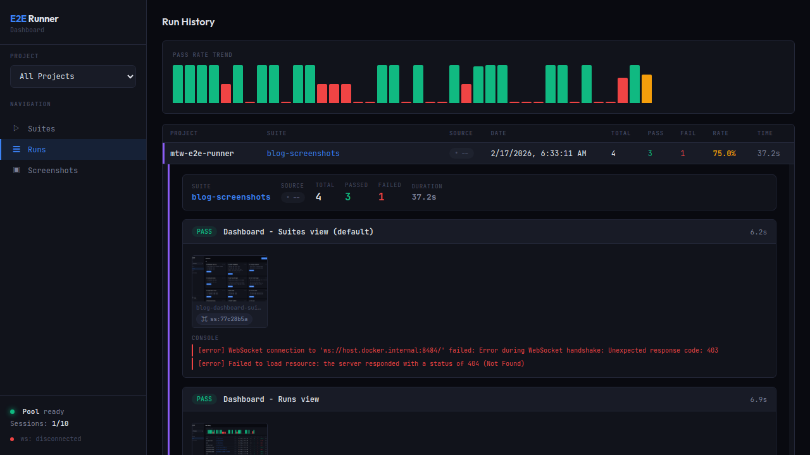
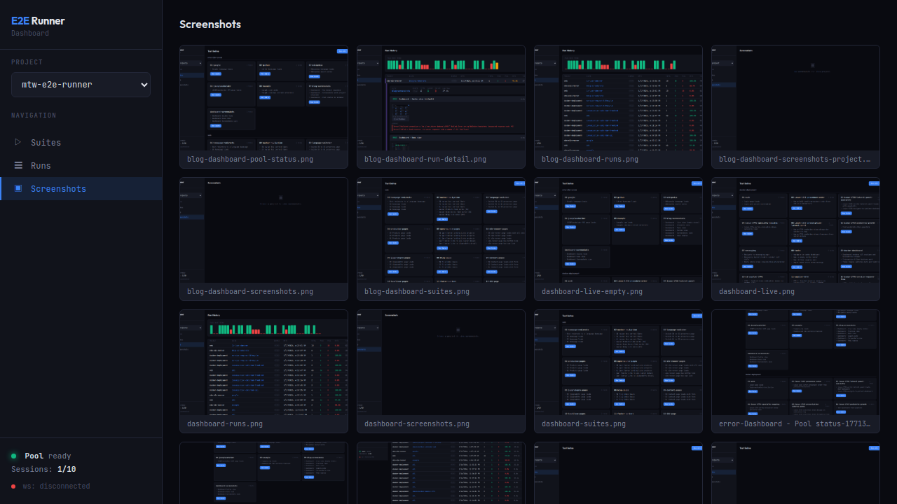
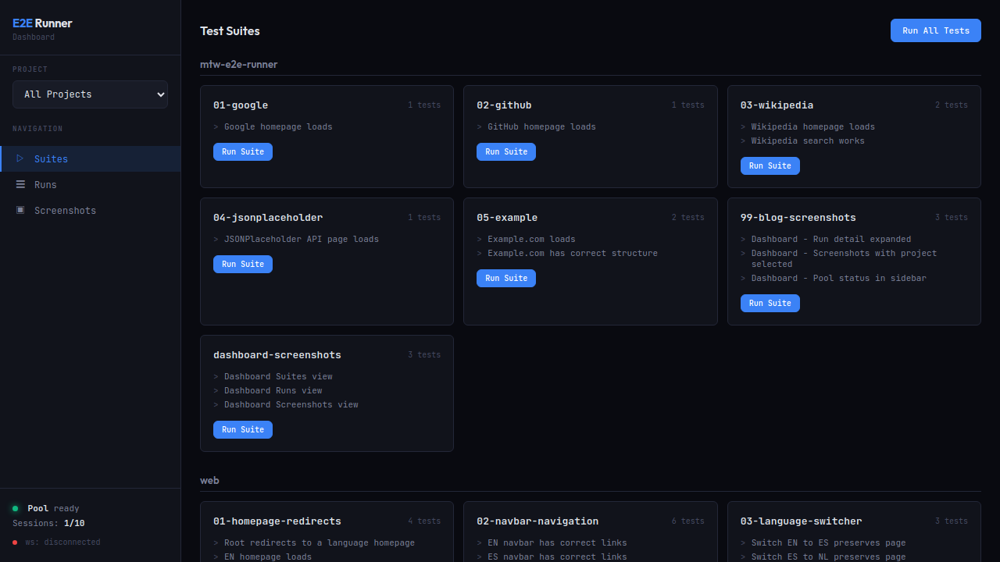

<p align="right">
  <a href="README.md">English</a> · <strong>Español</strong>
</p>

<h1 align="center">@matware/e2e-runner</h1>

<p align="center">
  <strong>El test runner E2E con IA nativa que escribe, ejecuta y depura tests por ti.</strong>
</p>

<p align="center">
  <a href="https://www.npmjs.com/package/@matware/e2e-runner"></a>
  
  <a href="https://www.npmjs.com/package/@matware/e2e-runner"></a>
  <a href="https://hub.docker.com/r/fastslack/e2e-runner-mcp"></a>
  <a href="https://github.com/fastslack/mtw-e2e-runner/stargazers"></a>
  <a href="LICENSE"></a>
  
  
  
  <a href="https://skills.sh"></a>
</p>

---

**E2E Runner** te deja testear tu app web sin escribir código de test. Los tests son JSON plano — y ni siquiera tenés que escribirlo vos: **se lo pedís a Claude Code.**

## 🎬 Escribí un test pidiéndolo — y miralo correr

<p align="center">
  
  <br/><sub><em>El dashboard en vivo mientras corre una suite — cada paso transmite una screenshot al feed, en tiempo real.</em></sub>
</p>

Con el [servidor MCP](https://modelcontextprotocol.io/) integrado, crear un test es una conversación — sin docs, sin sintaxis que memorizar:

> **Vos:** *Creá un test E2E para el flujo de login y ejecutalo.*
>
> **Claude Code:** *escribe el test, lo corre en un navegador real, y te responde —*
> ✅ `flujo-login` pasó en 2.3s · screenshot guardada · sin errores de red.

Por detrás, Claude escribió y ejecutó esto. Un test es **solo JSON** — una lista ordenada de lo que hace un usuario:

```json
[
  { "name": "flujo-login", "actions": [
    { "type": "goto", "value": "/login" },
    { "type": "type", "selector": "#email", "value": "usuario@test.com" },
    { "type": "type", "selector": "#password", "value": "secreto" },
    { "type": "click", "text": "Iniciar Sesión" },
    { "type": "assert_text", "text": "Bienvenido" },
    { "type": "screenshot", "value": "logueado.png" }
  ]}
]
```

Sin imports, sin `describe`/`it`, sin paso de compilación. Si lo podés leer, lo podés escribir — o simplemente pedilo.

**Conectalo a Claude Code (2 comandos):**

```bash
claude plugin marketplace add fastslack/mtw-e2e-runner
claude plugin install e2e-runner@matware
```

Ahora decí *"creá un test para X y ejecutalo"* — Claude obtiene 17 herramientas MCP, slash commands y agentes especializados.

> ¿Usás otro agente (Cursor, Codex, Copilot, [40+ más](https://github.com/vercel-labs/skills#supported-agents))? Instalá el skill: `npx -y skills@1.9.0 add fastslack/mtw-e2e-runner`

---

## 📖 Contenido

|   | Sección | Qué contiene |
|---|---------|--------------|
| 🚀 | **[Instalación &amp; primer test](#install)** | setup con npm · correr con tu propio Chrome (sin Docker), Obscura, o un pool con Docker |
| ✨ | **[Qué incluye](#features)** | resumen de funcionalidades de un vistazo |
| ✍️ | **[Escribir tests](#writing-tests)** | formato · catálogo completo de acciones · reintentos · serial · módulos · auth · hooks |
| 🤖 | **[Integración con IA](#ai)** | Claude Code · OpenCode · 17 herramientas MCP · verificación visual · issue-to-test |
| 📊 | **[Dashboard &amp; insights](#dashboard)** | dashboard en vivo · sistema de aprendizaje · logs de red · captura de screenshots |
| 🌐 | **[Drivers de navegador](#drivers)** | browserless · cdp · lightpanda · obscura · steel |
| ⚙️ | **[CLI, config &amp; CI](#reference)** | comandos · flags · `e2e.config.js` · GitHub Actions · API programática |

---

<a name="install"></a>

## 🚀 Instalación — es chiquita

```bash
npm install --save-dev @matware/e2e-runner@1.6.0
npx -y @matware/e2e-runner@1.6.0 init        # arma e2e/ con un test de ejemplo + config
```

Después elegí cómo correr el navegador. **No necesitás Docker** salvo que quieras el pool en paralelo:

### Opción 1 · Usá el Chrome que ya tenés — sin Docker ⭐

Lanzá cualquier navegador Chromium con un puerto de debugging y apuntá el runner ahí:

```bash
google-chrome --headless=new --remote-debugging-port=9222 &   # o brave / chromium / msedge
CHROME_POOL_URL=http://localhost:9222 POOL_DRIVER=cdp npx -y @matware/e2e-runner@1.6.0 run --all
```

O dejalo en `e2e.config.js` para no repetirlo:

```js
export default {
  baseUrl: 'http://localhost:3000',     // tu app — localhost común, sin hostname de docker
  poolUrls: ['http://localhost:9222'],
  poolDriver: 'cdp',
};
```

Nada que instalar más allá de npm, y `baseUrl` es solo `localhost` (el navegador está en tu máquina).

### Opción 2 · Obscura — un binario chiquito, sin Docker

Un solo binario de ~30 MB con anti-detección integrada. Instalalo una vez, corrélo, apuntá el runner:

```bash
obscura serve --port 9222 --stealth &
CHROME_POOL_URL=http://localhost:9222 POOL_DRIVER=obscura npx -y @matware/e2e-runner@1.6.0 run --all
```

`npx -y @matware/e2e-runner@1.6.0 pool start` (con `poolDriver: 'obscura'` en tu config) imprime el comando de instalación exacto para tu SO.

### Opción 3 · Pool con Docker — paralelo, para CI y suites grandes

Un pool de Chrome compartido y con cola que corre muchos tests a la vez:

```bash
npx -y @matware/e2e-runner@1.6.0 run --all     # la primera corrida levanta el pool de Docker por vos
```

Requiere Docker. Poné `baseUrl: 'http://host.docker.internal:3000'` para que el Chrome del contenedor llegue a tu app.

<details>
<summary><strong>¿Por qué <code>host.docker.internal</code> (solo opción Docker)?</strong></summary>

<br/>

Con el pool de Docker, Chrome corre dentro de un contenedor, así que `localhost` ahí es el contenedor — no tu máquina. `host.docker.internal` conecta con tu host. En Linux (Docker Engine, no Docker Desktop) agregá `--add-host=host.docker.internal:host-gateway`, o usá tu IP LAN. Las opciones 1 y 2 no tienen esto — el navegador es local, así que `localhost` funciona directo.

</details>

### Escribí tu primer test

Abrí `e2e/tests/sample.json` — un flujo es una lista ordenada de acciones:

```json
[
  { "name": "carga el home", "actions": [
    { "type": "goto", "value": "/" },
    { "type": "assert_text", "text": "Bienvenido" },
    { "type": "screenshot", "value": "home.png" }
  ]}
]
```

Corrélo con `npx -y @matware/e2e-runner@1.6.0 run --all`. Los resultados — pass/fail, tiempos, screenshots, errores de red — salen en tu terminal y en el [dashboard web](#dashboard) si lo tenés abierto.

<details>
<summary><strong>Agregar OpenCode</strong> (opcional)</summary>

<br/>

```bash
cp node_modules/@matware/e2e-runner/opencode.json ./
mkdir -p .opencode && cp -r node_modules/@matware/e2e-runner/.opencode/* .opencode/
```

Ver [OPENCODE.md](OPENCODE.md) para detalles.

</details>

### Actualizar

Cada método de instalación se actualiza por separado — actualizá el/los que uses:

```bash
# dependencia npm (por proyecto)
npm install --save-dev @matware/e2e-runner@1.6.0

# plugin de Claude Code
claude plugin update e2e-runner@matware

# instalación MCP-only (fijada a una versión exacta — subila para actualizar)
claude mcp add --transport stdio --scope user e2e-runner \
  -- npx -y -p @matware/e2e-runner@1.6.0 e2e-runner-mcp
```

> [!NOTE]
> Dos trampas: **(1)** `npx` prefiere una copia encontrada en el `node_modules` del proyecto por sobre su propia cache — si un proyecto pinea una versión vieja, el servidor MCP y el dashboard corren esa versión vieja, así que actualizá también la dependencia del proyecto. **(2)** Los procesos ya corriendo mantienen el código viejo en memoria: después de actualizar, reiniciá el dashboard y reconectá el servidor MCP (`/mcp` → `e2e-runner` → Reconnect, o reiniciá tu sesión).

---

<a name="features"></a>

## ✨ Qué incluye

🧪 **Tests sin código** — Archivos JSON que cualquier persona de tu equipo puede leer y escribir. Sin JavaScript, sin compilación, sin dependencia de framework.

🤖 **Testing con IA** — Claude Code crea, ejecuta y depura tests nativamente a través de 17 herramientas MCP. Pedile que "testee el flujo de checkout" y construye el JSON, lo ejecuta y te reporta el resultado.

🐛 **Pipeline Issue-to-Test** — Pegá una URL de issue de GitHub o GitLab. El runner lo busca, genera tests E2E, los ejecuta y te dice: *bug confirmado* o *no reproducible*.

👁️ **Verificación visual** — Describí cómo debería verse la página en texto plano. La IA captura un screenshot y juzga si pasa o falla contra tu descripción. Sin configurar pixel-diffing.

🧠 **Sistema de aprendizaje** — Rastrea la estabilidad de los tests entre ejecuciones. Detecta tests flaky, selectores inestables, APIs lentas y patrones de error — y después muestra insights accionables.

⚡ **Ejecución paralela** — Ejecutá N tests simultáneamente contra un pool compartido de navegadores (browserless, CDP, Lightpanda, Obscura o Steel). Modo serial disponible para tests que comparten estado.

🎯 **Drivers de navegador intercambiables** — Elegí el motor que le conviene a cada test: Chrome real vía browserless, Lightpanda u Obscura para corridas livianas, Steel para sesiones gestionadas. Definí `driver` por test o forzá toda la corrida con `--driver`.

📊 **Dashboard en tiempo real** — Vista de ejecución en vivo, historial de ejecuciones con gráficos de tasa de éxito, galería de screenshots con búsqueda por hash, logs de requests de red expandibles.

🔁 **Reintentos inteligentes** — Reintentos a nivel de test y de acción con delays configurables. Los tests flaky se detectan y marcan automáticamente.

📦 **Módulos reutilizables** — Extraé flujos comunes (login, navegación, setup) en módulos parametrizados y referencialos con `$use`.

🏗️ **Listo para CI** — Salida JUnit XML, código de salida 1 ante fallos, screenshots de error automáticos. Ejemplo listo para GitHub Actions incluido.

🌐 **Multi-proyecto** — Un dashboard agrega resultados de tests de todos tus proyectos. Un pool de Chrome los sirve a todos.

🐳 **Portable** — Chrome corre en Docker, los tests son archivos JSON en tu repo. Funciona en cualquier máquina con Node.js y Docker.

---

<a name="writing-tests"></a>

## ✍️ Escribir tests

Todo sobre crear tests — el formato de archivo, el vocabulario completo de acciones, reintentos, aislamiento de estado y reutilización. Expandí lo que necesites:

<details>
<summary><strong>Formato de tests &amp; estructura de archivos</strong></summary>

<br/>

Cada archivo `.json` en `e2e/tests/` contiene un array de tests. Cada test tiene un `name` y `actions` secuenciales:

```json
[
  {
    "name": "carga-homepage",
    "actions": [
      { "type": "goto", "value": "/" },
      { "type": "assert_visible", "selector": "body" },
      { "type": "assert_url", "value": "/" },
      { "type": "screenshot", "value": "homepage.png" }
    ]
  }
]
```

Los archivos de suite pueden tener prefijos numéricos para ordenamiento (`01-auth.json`, `02-dashboard.json`). El flag `--suite` matchea con o sin prefijo, así que `--suite auth` encuentra `01-auth.json`.

</details>

<details>
<summary><strong>Catálogo de acciones</strong> — navegación, input &amp; interacción</summary>

<br/>

| Acción | Campos | Descripción |
|--------|--------|-------------|
| `goto` | `value` | Navegar a URL (relativa a `baseUrl` o absoluta) |
| `click` | `selector` o `text` | Click por selector CSS o texto visible. El modo texto también acepta `scope: "dialog"`, `visible: true`, `last: true` |
| `type` / `fill` | `selector`, `value` | Limpiar campo y escribir texto |
| `wait` | `selector`, `text`, `gone`, o `value` (ms) | Esperar a que aparezca un elemento/texto, a que `gone` desaparezca (spinner/diálogo), o delay fijo. Preferí condiciones antes que sleeps con `value` |
| `screenshot` | `value` (nombre de archivo) | Capturar un screenshot |
| `select` | `selector`, `value` | Seleccionar una opción de dropdown |
| `clear` | `selector` | Limpiar un campo de input |
| `press` | `value` | Presionar una tecla (`Enter`, `Tab`, etc.) |
| `scroll` | `selector` o `value` (px) | Scroll a elemento o por cantidad de píxeles |
| `hover` | `selector` | Hover sobre un elemento |
| `evaluate` | `value` | Ejecutar JavaScript en el contexto del navegador |
| `navigate` | `value` | Navegación del navegador (`back`, `forward`, `reload`) |
| `clear_cookies` | — | Limpiar todas las cookies de la página actual |
| `wait_network_idle` | opcional `value` (ms de inactividad, default 500), `timeout` | Esperar hasta que la red esté inactiva durante `value` ms — útil después de acciones que disparan requests en segundo plano |
| `set_storage` | `value` (`"clave=valor"`), opcional `selector: "session"` | Setear una clave de `localStorage` (o `sessionStorage` con `selector: "session"`) |
| `gql` | `value` (query), opcional `text` (variables JSON), opcional `selector` (aserción) | Ejecutar una query/mutation GraphQL vía `fetch` en la página, con el token de auth leído de `localStorage`. Falla ante errores GraphQL. `selector` es una expresión JS que se evalúa contra la respuesta `r` (ej. `"r.data.users.length > 0"`). Instala `window.__e2eGql` para usar en `evaluate` posteriores |

**Click por texto** — cuando `click` usa `text` en vez de `selector`, busca en elementos interactivos y de contenido comunes:

```
button, a, [role="button"], [role="tab"], [role="menuitem"], [role="option"],
[role="listitem"], div[class*="cursor"], span, li, td, th, label, p, h1-h6
```

```json
{ "type": "click", "text": "Iniciar Sesión" }
```

</details>

<details>
<summary><strong>Aserciones</strong> — verificar texto, elementos, URLs, cantidades &amp; red</summary>

<br/>

| Acción | Campos | Descripción |
|--------|--------|-------------|
| `assert_text` | `text` | Verificar que el texto existe en cualquier parte de la página (substring) |
| `assert_no_text` | `text` | Verificar que el texto NO aparece en ninguna parte de la página — opuesto de `assert_text` |
| `assert_text_in` | `selector`, `text`, opcional `value: "exact"` | Verificar texto dentro de un contenedor acotado. `text` es una regex case-insensitive por defecto; `value: "exact"` cambia a substring case-sensitive |
| `assert_element_text` | `selector`, `text`, opcional `value: "exact"` | Verificar que el texto del elemento contiene (o coincide exactamente con) el texto esperado |
| `assert_url` | `value` | Verificar la URL actual. Los paths (`/dashboard`) comparan solo contra el pathname |
| `assert_visible` | `selector` | Verificar que el elemento existe y es visible |
| `assert_not_visible` | `selector` | Verificar que el elemento está oculto o no existe |
| `assert_attribute` | `selector`, `value` | Verificar atributo: `"type=email"` para valor, `"disabled"` para existencia |
| `assert_class` | `selector`, `value` | Verificar que el elemento tiene una clase CSS |
| `assert_input_value` | `selector`, `value` | Verificar que el `.value` de input/select/textarea contiene el texto |
| `assert_matches` | `selector`, `value` (regex) | Verificar que el texto del elemento coincide con un patrón regex |
| `assert_count` | `selector`, `value` | Verificar cantidad de elementos: exacto (`"5"`), u operadores (`">3"`, `">=1"`, `"<10"`) |
| `assert_no_network_errors` | — | Falla si alguna request de red falló (ej. `ERR_CONNECTION_REFUSED`) |
| `assert_storage` | `value` (`"clave"` o `"clave=esperado"`), opcional `selector: "session"` | Verificar que una clave de `localStorage`/`sessionStorage` existe o tiene un valor específico |
| `assert_visual` | `value` (imagen golden), opcional `selector`, `text` (diff máximo, ej. `"0.02"`), `fullPage`, `maskRegions`, `threshold` | Regresión visual: compara un screenshot contra una imagen golden de referencia. La primera corrida guarda la golden; las siguientes fallan si difieren más píxeles que el umbral (default 2%) y escriben una imagen de diff |
| `get_text` | `selector` | Extraer texto del elemento (no es aserción, nunca falla). Resultado: `{ value: "..." }` |

</details>

<details>
<summary><strong>Acciones para frameworks</strong> — React/MUI sin boilerplate de <code>evaluate</code></summary>

<br/>

Estas acciones manejan patrones comunes en apps React/MUI que normalmente requieren boilerplate extenso con `evaluate`:

| Acción | Campos | Descripción |
|--------|--------|-------------|
| `type_react` | `selector`, `value`, opcional `blur`, `waitAfter` | Escribir en inputs controlados de React usando el setter nativo de value. Dispara eventos `input` + `change` para que el estado de React se actualice. `blur: true` confirma al perder foco; `waitAfter: "<ms>"` espera después (autocomplete con debounce). |
| `click_regex` | `text` (regex), opcional `selector`, opcional `value: "last"` | Click en elemento cuyo textContent coincide con una regex (case-insensitive). Default: primer match. Usar `value: "last"` para el último. |
| `click_option` | `text` | Click en un elemento `[role="option"]` por texto — común en dropdowns de autocomplete/select. |
| `select_combobox` | `text`, opcional `selector`, `filter`, `openWait`/`filterWait`/`waitAfter` | Abre un MUI Autocomplete/Select, opcionalmente escribe `filter`, y hace click en la opción que coincide con `text`. Cae a `[role="option"]`, `.MuiAutocomplete-option`, `li.MuiMenuItem-root`. |
| `focus_autocomplete` | `text` (texto del label) | Hacer focus en un input de autocomplete por texto de su label. Soporta MUI y genérico `[role="combobox"]`. |
| `click_chip` | `text` | Click en un chip/tag por texto. Busca en `[class*="Chip"]`, `[class*="chip"]`, `[data-chip]`. |
| `click_icon` | `value` (id del ícono), opcional `selector` (scope) | Click en un ícono por fragmento de `data-testid`/`data-icon`/`aria-label`/clase o `<title>` del SVG — MUI, FontAwesome, Heroicons, etc. Clickea el ancestro clickeable más cercano (botón, link, tab). |
| `click_menu_item` | `text`, opcional `selector` (scope) | Click en un ítem de menú por texto en `[role="menuitem"]`, `.dropdown-item`, `.menu-item`, `MenuItem` de MUI. |
| `click_in_context` | `text` (texto del contenedor), `selector` (hijo) | Click en un elemento hijo dentro del contenedor más chico que coincide con `text` — ej. el botón de borrar de una card/fila específica. |

```json
// Antes: 5 líneas de boilerplate con evaluate
{ "type": "evaluate", "value": "const input = document.querySelector('#search'); const nativeSet = Object.getOwnPropertyDescriptor(window.HTMLInputElement.prototype, 'value').set; nativeSet.call(input, 'term'); input.dispatchEvent(new Event('input', {bubbles: true})); input.dispatchEvent(new Event('change', {bubbles: true}));" }

// Después: 1 acción
{ "type": "type_react", "selector": "#search", "value": "term" }
```

</details>

<details>
<summary><strong>Acciones multi-tab</strong> — popups, ventanas OAuth &amp; flujos entre pestañas</summary>

<br/>

| Acción | Campos | Descripción |
|--------|--------|-------------|
| `open_tab` | `value` (URL), opcional `text` (etiqueta) | Abrir una pestaña nueva y navegar a la URL (relativa a `baseUrl` o absoluta). La etiqueta por defecto es `tab-<n>` |
| `switch_tab` | `value` | Cambiar la pestaña activa por etiqueta, índice numérico, o coincidencia de título/URL (regex o substring). `"default"` vuelve a la pestaña original |
| `wait_for_tab` | opcional `text` (etiqueta), `timeout` | Esperar una pestaña/popup nueva abierta por la app (`window.open`, `target="_blank"`) y activarla |
| `assert_tab_count` | `value` | Verificar la cantidad de pestañas abiertas: exacto (`"2"`) u operadores (`">=2"`) |
| `close_tab` | opcional `value` (etiqueta) | Cerrar la pestaña actual (o la indicada) y volver a la última que queda |

Todas las acciones siguientes corren en la pestaña activa:

```json
{ "type": "click", "text": "Abrir reporte" }
{ "type": "wait_for_tab", "text": "reporte" }
{ "type": "assert_text", "text": "Resultados trimestrales" }
{ "type": "close_tab" }
```

</details>

<details>
<summary><strong>Reintentos &amp; detección de flaky</strong></summary>

<br/>

**Reintento a nivel de test** — reintentar un test completo ante fallo. Configurar globalmente o por test:

```json
{ "name": "test-flaky", "retries": 3, "timeout": 15000, "actions": [...] }
```

Los tests que pasan después de reintentar se marcan como **flaky** en el reporte y el sistema de aprendizaje.

**Reintento a nivel de acción** — reintentar una acción individual sin re-ejecutar el test completo. Útil para clicks y waits sensibles al timing:

```json
{ "type": "click", "selector": "#btn-dinamico", "retries": 3 }
{ "type": "wait", "selector": ".carga-lazy", "retries": 2 }
```

Configurar globalmente: `actionRetries` en config, `--action-retries <n>` en CLI, o variable de entorno `ACTION_RETRIES`. Delay entre reintentos: `actionRetryDelay` (default 500ms).

</details>

<details>
<summary><strong>Tests seriales</strong> — para tests que comparten estado</summary>

<br/>

Los tests que comparten estado (ej. dos tests modificando el mismo registro) pueden competir al ejecutarse en paralelo. Marcalos como seriales:

```json
{ "name": "crear-paciente", "serial": true, "actions": [...] }
{ "name": "verificar-lista-pacientes", "serial": true, "actions": [...] }
```

Los tests seriales se ejecutan uno a la vez **después** de que todos los tests paralelos terminen — previniendo interferencia sin ralentizar los tests independientes.

</details>

<details>
<summary><strong>Testing de apps con autenticación</strong></summary>

<br/>

Lo más simple — loguearse por la UI como un usuario real:

```json
{
  "hooks": {
    "beforeEach": [
      { "type": "goto", "value": "/login" },
      { "type": "type", "selector": "#email", "value": "test@example.com" },
      { "type": "type", "selector": "#password", "value": "test-password" },
      { "type": "click", "text": "Iniciar Sesión" },
      { "type": "wait", "selector": ".dashboard" }
    ]
  },
  "tests": [...]
}
```

Para SPAs con JWT, saltá el formulario inyectando el token directamente:

```json
{ "type": "set_storage", "value": "accessToken=eyJhbGciOiJIUzI1NiIs..." }
```

O configuralo globalmente:

```js
// e2e.config.js
export default {
  authToken: 'eyJhbGciOiJIUzI1NiIs...',
  authStorageKey: 'accessToken',
};
```

Cada test se ejecuta en un **contexto de browser nuevo**, así que el estado de auth está automáticamente limpio entre tests.

> **Más estrategias:** Auth por cookies, inyección de headers HTTP, bypasses de OAuth/SSO, módulos de auth reutilizables y testing por roles — ver [docs/authentication.md](docs/authentication.md)

</details>

<details>
<summary><strong>Módulos reutilizables</strong> — extraé flujos comunes con <code>$use</code></summary>

<br/>

Extraé flujos comunes en módulos parametrizados:

```json
// e2e/modules/login.json
{
  "$module": "login",
  "description": "Iniciar sesión vía formulario de login",
  "params": {
    "email": { "required": true, "description": "Email del usuario" },
    "password": { "required": true, "description": "Contraseña" }
  },
  "actions": [
    { "type": "goto", "value": "/login" },
    { "type": "type", "selector": "#email", "value": "{{email}}" },
    { "type": "type", "selector": "#password", "value": "{{password}}" },
    { "type": "click", "text": "Iniciar Sesión" },
    { "type": "wait", "value": "2000" }
  ]
}
```

Usar en tests:

```json
{
  "name": "carga-dashboard",
  "actions": [
    { "$use": "login", "params": { "email": "user@test.com", "password": "secret" } },
    { "type": "assert_text", "text": "Dashboard" }
  ]
}
```

Los módulos soportan validación de parámetros (los requeridos fallan rápido), bloques condicionales (`{{#param}}...{{/param}}`), composición anidada y detección de ciclos.

</details>

<details>
<summary><strong>Hooks</strong> — beforeAll / beforeEach / afterEach / afterAll</summary>

<br/>

Ejecutá acciones en puntos del ciclo de vida. Definir globalmente en config o por suite:

```json
{
  "hooks": {
    "beforeAll": [{ "type": "goto", "value": "/setup" }],
    "beforeEach": [{ "type": "goto", "value": "/" }],
    "afterEach": [{ "type": "screenshot", "value": "despues.png" }],
    "afterAll": []
  },
  "tests": [...]
}
```

> **Importante:** `beforeAll` se ejecuta en una página de navegador separada que se cierra antes de que empiecen los tests. Usá `beforeEach` para estado que los tests necesitan (cookies, localStorage, tokens de auth).

</details>

<details>
<summary><strong>Patrones de exclusión</strong> — saltar borradores de <code>--all</code></summary>

<br/>

Excluir tests exploratorios o borradores de las ejecuciones con `--all`:

```js
// e2e.config.js
export default {
  exclude: ['explore-*', 'debug-*', 'draft-*'],
};
```

Las ejecuciones de suites individuales (`--suite`) no son afectadas por los patrones de exclusión.

</details>

---

<a name="ai"></a>

## 🤖 Integración con IA

El punto central: tu agente escribe, ejecuta y verifica los tests por vos.

<details>
<summary><strong>Claude Code</strong> — instalación del plugin &amp; solo-MCP</summary>

<br/>

```bash
claude plugin marketplace add fastslack/mtw-e2e-runner
claude plugin install e2e-runner@matware
```

Le da a Claude 17 herramientas MCP, un skill de workflow, 4 slash commands (`/e2e-runner:run`, `/e2e-runner:create-test`, `/e2e-runner:verify-issue`, `/e2e-runner:capture`) y 3 agentes especializados (test-analyzer, test-creator, test-improver).

**Instalar solo MCP** (herramientas sin skill/commands/agents):

```bash
claude mcp add --transport stdio --scope user e2e-runner \
  -- npx -y -p @matware/e2e-runner@1.6.0 e2e-runner-mcp
```

</details>

<details>
<summary><strong>OpenCode</strong></summary>

<br/>

```bash
cp node_modules/@matware/e2e-runner/opencode.json ./
mkdir -p .opencode && cp -r node_modules/@matware/e2e-runner/.opencode/* .opencode/
```

Ver [OPENCODE.md](OPENCODE.md) para detalles.

</details>

<details>
<summary><strong>Las 17 herramientas MCP</strong></summary>

<br/>

| Herramienta | Descripción |
|-------------|-------------|
| `e2e_run` | Ejecutar tests (todas, por suite o por archivo) |
| `e2e_list` | Listar suites de tests disponibles |
| `e2e_create_test` | Crear un nuevo archivo JSON de test |
| `e2e_create_module` | Crear un módulo reutilizable |
| `e2e_pool_status` | Verificar salud del pool de Chrome |
| `e2e_app_pool_status` | Inspeccionar el pool de entornos de la app (forks, puertos, drivers) |
| `e2e_screenshot` | Recuperar un screenshot por hash |
| `e2e_capture` | Capturar screenshot de cualquier URL |
| `e2e_analyze` | Extraer estructura de página (elementos interactivos, forms, headings) y emitir scaffolds de test |
| `e2e_dashboard_start` | Iniciar dashboard web |
| `e2e_dashboard_stop` | Detener dashboard web |
| `e2e_dashboard_restart` | Reiniciar el dashboard (nuevo dir/puerto, limpiar sesiones colgadas) |
| `e2e_issue` | Buscar issue y generar tests |
| `e2e_network_logs` | Consultar logs de red de una ejecución |
| `e2e_learnings` | Consultar insights de estabilidad |
| `e2e_vars` | Gestionar variables de proyecto `{{var.KEY}}` en SQLite |
| `e2e_neo4j` | Gestionar grafo de conocimiento Neo4j |

> Pool start/stop son solo CLI — no se exponen vía MCP.

</details>

<details>
<summary><strong>Verificación visual</strong> — describí la página, la IA la juzga</summary>

<br/>

Describí cómo debería verse la página — la IA juzga si pasa o falla a partir de screenshots:

```json
{
  "name": "carga-dashboard",
  "expect": "Lista de pacientes con al menos 3 filas, sin mensajes de error, sidebar con links de navegación",
  "actions": [
    { "type": "goto", "value": "/dashboard" },
    { "type": "wait", "selector": ".patient-list" }
  ]
}
```

Después de que las acciones del test terminan, el runner auto-captura un screenshot de verificación. La respuesta MCP incluye el hash del screenshot — Claude Code lo recupera y verifica visualmente contra tu descripción `expect`. No requiere API key.

</details>

<details>
<summary><strong>Issue-to-test</strong> — convertí un reporte de bug en un test ejecutable</summary>

<br/>

Convertí issues de GitHub y GitLab en tests E2E ejecutables. Pegá una URL de issue y obtené tests ejecutables — automáticamente.

**Cómo funciona:**

1. **Buscar** — Obtiene los detalles del issue (título, cuerpo, labels) vía CLI `gh` o `glab`
2. **Generar** — La IA crea acciones JSON de test basadas en la descripción del issue
3. **Ejecutar** — Opcionalmente ejecuta los tests inmediatamente para verificar si un bug es reproducible

```bash
# Buscar y mostrar
e2e-runner issue https://github.com/owner/repo/issues/42

# Generar un archivo de test vía Claude API
e2e-runner issue https://github.com/owner/repo/issues/42 --generate

# Generar + ejecutar + reportar
e2e-runner issue https://github.com/owner/repo/issues/42 --verify
# -> "BUG CONFIRMED" o "NOT REPRODUCIBLE"
```

En Claude Code, simplemente pedí:
> "Buscá el issue #42 y creá tests E2E para verificarlo"

**Lógica de verificación de bugs:** Los tests generados verifican el comportamiento **correcto**. Si el test falla = bug confirmado. Si todos los tests pasan = no reproducible.

**Autenticación:** GitHub requiere CLI `gh`, GitLab requiere CLI `glab`. GitLab self-hosted es soportado.

</details>

---

<a name="dashboard"></a>

## 📊 Dashboard &amp; insights

```bash
e2e-runner dashboard                  # Iniciar en puerto por defecto 8484
e2e-runner dashboard --port 9090      # Puerto personalizado
```

<details>
<summary><strong>Recorrido del dashboard web</strong> — vista en vivo, historial, galería, pool</summary>

<br/>

**Ejecución en vivo** — monitoreá tests en tiempo real con progreso paso a paso, duraciones y cantidad de workers activos.

<p align="center">
  
</p>

**Suites de tests** — explorá todas las suites de múltiples proyectos. Ejecutá una suite individual o todas con un click.

<p align="center">
  
</p>

**Historial de ejecuciones** — seguí las tendencias de tasa de éxito con el gráfico integrado. Click en cualquier fila para expandir el detalle completo.

<p align="center">
  
</p>

**Detalle de ejecución** — badges PASS/FAIL, thumbnails de screenshots con hashes copiables (`ss:77c28b5a`), errores de consola formateados y logs de requests de red.

<p align="center">
  
</p>

**Galería de screenshots** — explorá todos los screenshots capturados con búsqueda por hash (acciones, errores y capturas de verificación).

<p align="center">
  
</p>

**Estado del pool** — salud del pool de Chrome: slots disponibles, sesiones activas, presión de memoria.

<p align="center">
  
</p>

</details>

<details>
<summary><strong>Sistema de aprendizaje</strong> — tests flaky, selectores inestables, APIs lentas</summary>

<br/>

El runner aprende de cada ejecución — construyendo conocimiento sobre tu suite de tests con el tiempo. Consultá insights a través de la herramienta MCP `e2e_learnings`:

| Consulta | Retorna |
|----------|---------|
| `summary` | Resumen de salud completo: tasa de éxito, tests flaky, selectores inestables, problemas de API |
| `flaky` | Tests que pasan solo después de reintentos |
| `selectors` | Selectores CSS con alta tasa de fallo |
| `pages` | Páginas con errores de consola, fallos de red, problemas de tiempo de carga |
| `apis` | Endpoints de API con tasas de error y latencia (auto-normalizado: UUIDs, hashes, IDs) |
| `errors` | Patrones de error más frecuentes, categorizados |
| `trends` | Tasa de éxito en el tiempo (cambia automáticamente a vista por hora cuando todos los datos son del mismo día) |
| `test:<nombre>` | Historial detallado de un test específico |
| `page:<path>` | Historial detallado de una página específica |
| `selector:<valor>` | Historial detallado de un selector específico |

**Almacenamiento y exportación:**
- SQLite (`~/.e2e-runner/dashboard.db`) — por defecto, sin configuración
- Grafo de conocimiento Neo4j — opcional, para análisis basado en relaciones. Gestionar vía herramienta MCP `e2e_neo4j` o `docker compose`
- Reporte markdown (`e2e/learnings.md`) — auto-generado después de cada ejecución

**Narración de tests:** Cada ejecución genera una narrativa legible de lo que pasó paso a paso, visible en la salida del CLI y en el dashboard.

</details>

<details>
<summary><strong>Manejo de errores de red</strong> — aserciones, flag global, logging completo</summary>

<br/>

**Aserción explícita** — colocá `assert_no_network_errors` después de cargas de página críticas:

```json
{ "type": "goto", "value": "/dashboard" },
{ "type": "wait", "selector": ".loaded" },
{ "type": "assert_no_network_errors" }
```

**Flag global** — configurá `failOnNetworkError: true` para fallar automáticamente cualquier test con errores de red:

```bash
e2e-runner run --all --fail-on-network-error
```

Cuando está deshabilitado (por defecto), el runner igual recolecta y reporta errores de red — la respuesta MCP incluye un warning cuando los tests pasan pero tienen errores de red.

**Logging completo de red** — todas las requests XHR/fetch se capturan con URL, método, status, duración, headers de request/response y cuerpo de response (truncado a 50KB). Visible en el dashboard con filas de detalle expandibles.

Flujo de drill-down MCP:

```
1. e2e_run          → networkSummary compacto + runDbId
2. e2e_network_logs(runDbId)                     → todas las requests (url, method, status, duration)
3. e2e_network_logs(runDbId, errorsOnly: true)   → solo requests fallidas
4. e2e_network_logs(runDbId, includeHeaders: true) → con headers
5. e2e_network_logs(runDbId, includeBodies: true)  → cuerpos completos de request/response
```

La respuesta de `e2e_run` se mantiene compacta (~5KB) sin importar cuántas requests se capturaron. Usá `e2e_network_logs` con el `runDbId` retornado para profundizar bajo demanda.

</details>

<details>
<summary><strong>Captura de screenshots</strong> — snapshot de cualquier URL bajo demanda</summary>

<br/>

Capturá screenshots de cualquier URL bajo demanda — sin necesidad de suite de tests:

```bash
e2e-runner capture https://example.com
e2e-runner capture https://example.com --full-page --selector ".loaded" --delay 2000
```

Vía MCP, la herramienta `e2e_capture` soporta `authToken` y `authStorageKey` para páginas autenticadas — inyecta el token en localStorage antes de navegar.

Cada screenshot recibe un hash determinístico (`ss:a3f2b1c9`). Usá `e2e_screenshot` para recuperar cualquier screenshot por hash — devuelve la imagen con metadata (nombre del test, paso, tipo).

</details>

---

<a name="drivers"></a>

## 🌐 Drivers de navegador

El runner puede hablar con múltiples motores de navegador a través de distintos drivers. El default es **`auto`** — sondea cada URL de pool y elige el driver correcto por pool.

| Driver | Motor | Sonda de detección | Cuándo usarlo |
|--------|-------|--------------------|---------------|
| `browserless` | Chromium real vía [browserless](https://www.browserless.io/) | `/pressure` devuelve JSON | Default. Ejecución JS de nivel producción, screencast, comportamiento Chrome completo |
| `cdp` | CDP-compatible genérico (Chrome crudo, etc.) | `/json/version` alcanzable | Fallback para cualquier servidor CDP que no sea uno de los otros |
| `lightpanda` | [Lightpanda](https://lightpanda.io) (Zig) | `/json/version` Browser=lightpanda | ~9× más rápido, ~16× menos memoria que Chrome headless — ideal para tests tipo scrape de alto volumen |
| `obscura` | [Obscura](https://github.com/h4ckf0r0day/obscura) (Rust + V8) | `/json/version` Browser=obscura | ~30 MB de RAM, anti-detección integrada (`--stealth`), cercano a Chrome real vía Puppeteer |
| `steel` | [Steel Browser](https://steel.dev) | `/v1/sessions` devuelve JSON | Ciclo de vida de sesión gestionado, API REST para orquestación |

<details>
<summary><strong>Elegir driver por test / forzar uno por corrida</strong></summary>

<br/>

```json
{
  "tests": [
    {
      "name": "flujo checkout (JS pesado, Chrome real)",
      "driver": "browserless",
      "actions": [...]
    },
    {
      "name": "scrape de producto (liviano)",
      "driver": "obscura",
      "fallbackDriver": "cdp",
      "actions": [...]
    }
  ]
}
```

`driver` es opcional. Si se define, solo los pools cuyo driver detectado coincida son candidatos. `fallbackDriver` es **opt-in explícito** — sin él, un driver faltante falla el test con un mensaje claro. La ocupación del pool **no** dispara fallback; el runner espera dentro del conjunto filtrado.

Forzar un driver para toda la corrida (los flags de CLI ganan sobre los campos por test — útil para benchmarks A/B):

```bash
e2e-runner run --all --driver obscura
e2e-runner run --all --driver obscura --fallback-driver cdp
```

</details>

<details>
<summary><strong>Correr cada driver localmente</strong></summary>

<br/>

```bash
# browserless (default) — gestionado por `pool start`
e2e-runner pool start

# Lightpanda — pool start usa templates/docker-compose-lightpanda.yml
e2e-runner pool start                 # con poolDriver: 'lightpanda' en config

# Obscura — instalá el binario y corrélo vos
curl -LO https://github.com/h4ckf0r0day/obscura/releases/latest/download/obscura-x86_64-linux.tar.gz
tar xzf obscura-x86_64-linux.tar.gz
./obscura serve --port 9222 --stealth
# después apuntá el runner: poolUrls: ['http://localhost:9222'], poolDriver: 'obscura'
```

</details>

---

<a name="reference"></a>

## ⚙️ CLI, config &amp; CI

<details>
<summary><strong>Comandos CLI</strong></summary>

<br/>

```bash
# Ejecutar tests
e2e-runner run --all                  # Todas las suites
e2e-runner run --suite auth           # Suite individual
e2e-runner run --tests path/to.json   # Archivo específico
e2e-runner run --inline '<json>'      # JSON inline

# Gestión del pool (solo CLI, no MCP)
e2e-runner pool start                 # Iniciar contenedor Chrome
e2e-runner pool stop                  # Detener contenedor Chrome
e2e-runner pool status                # Verificar salud del pool

# Issue-to-test
e2e-runner issue <url>                # Buscar issue
e2e-runner issue <url> --generate     # Generar test vía IA
e2e-runner issue <url> --verify       # Generar + ejecutar + reportar

# Dashboard
e2e-runner dashboard                  # Iniciar dashboard web

# Otros
e2e-runner list                       # Listar suites disponibles
e2e-runner capture <url>              # Screenshot bajo demanda
e2e-runner init                       # Crear estructura del proyecto
```

</details>

<details>
<summary><strong>Opciones de CLI</strong></summary>

<br/>

| Flag | Default | Descripción |
|------|---------|-------------|
| `--base-url <url>` | `http://host.docker.internal:3000` | URL base de la aplicación |
| `--pool-url <ws>` | `ws://localhost:3333` | URL WebSocket del pool de Chrome |
| `--concurrency <n>` | `3` | Workers de test paralelos |
| `--retries <n>` | `0` | Reintentar tests fallidos N veces |
| `--action-retries <n>` | `0` | Reintentar acciones fallidas N veces |
| `--test-timeout <ms>` | `60000` | Timeout por test |
| `--timeout <ms>` | `10000` | Timeout default de acción |
| `--output <format>` | `json` | Reporte: `json`, `junit`, `both` |
| `--env <name>` | `default` | Perfil de entorno |
| `--fail-on-network-error` | `false` | Fallar tests con errores de red |
| `--project-name <name>` | nombre del dir | Nombre display del proyecto |
| `--driver <name>` | _(por test)_ | Forzar driver de pool para la corrida: `browserless`, `cdp`, `lightpanda`, `obscura`, `steel` |
| `--fallback-driver <name>` | _ninguno_ | Fallback explícito si no hay pool con `--driver` alcanzable |

</details>

<details>
<summary><strong>Configuración</strong> — <code>e2e.config.js</code> &amp; prioridad</summary>

<br/>

Creá `e2e.config.js` en la raíz de tu proyecto:

```js
export default {
  baseUrl: 'http://host.docker.internal:3000',
  concurrency: 4,
  retries: 2,
  actionRetries: 1,
  testTimeout: 30000,
  outputFormat: 'both',
  failOnNetworkError: true,
  exclude: ['explore-*', 'debug-*'],

  hooks: {
    beforeEach: [{ type: 'goto', value: '/' }],
  },

  environments: {
    staging: { baseUrl: 'https://staging.example.com' },
    production: { baseUrl: 'https://example.com', concurrency: 5 },
  },
};
```

**Prioridad de configuración (la más alta gana):**

1. Flags de CLI
2. Variables de entorno
3. Archivo de config (`e2e.config.js` o `e2e.config.json`)
4. Defaults

Cuando se usa `--env <nombre>`, el perfil correspondiente sobreescribe todo.

</details>

<details>
<summary><strong>CI/CD</strong> — JUnit XML &amp; GitHub Actions</summary>

<br/>

```bash
e2e-runner run --all --output junit
```

```yaml
jobs:
  e2e:
    runs-on: ubuntu-latest
    steps:
      - uses: actions/checkout@v4
      - uses: actions/setup-node@v4
        with:
          node-version: 20
      - run: npm ci
      - run: npx -y @matware/e2e-runner@1.6.0 pool start
      - run: npx -y @matware/e2e-runner@1.6.0 run --all --output junit
      - uses: mikepenz/action-junit-report@v4
        if: always()
        with:
          report_paths: e2e/screenshots/junit.xml
```

</details>

<details>
<summary><strong>API programática</strong></summary>

<br/>

```js
import { createRunner } from '@matware/e2e-runner';

const runner = await createRunner({ baseUrl: 'http://localhost:3000' });

const report = await runner.runAll();
const report = await runner.runSuite('auth');
const report = await runner.runFile('e2e/tests/login.json');
const report = await runner.runTests([
  { name: 'check-rapido', actions: [{ type: 'goto', value: '/' }] },
]);
```

**¿Embebés el runner en otro programa?** Usá la entrada estable y sin efectos secundarios — resultados versionados (`schemaVersion: 1`, con JSON Schema), sin DB del dashboard / learnings / llamadas a LLM, sin addons nativos:

```js
import { runSuite, inspectPage } from '@matware/e2e-runner/embed';

const result = await runSuite(tests, { baseUrl, poolUrl, screenshotsDir, vars, env });
const page = await inspectPage('http://app:3000/login', { poolUrl, screenshotsDir });
```

Ver [docs/embedding.md](docs/embedding.md) (en inglés).

</details>

---

## Requisitos

- **Node.js** >= 20
- **Docker** — solo para la [Opción 3](#install) (el pool de Chrome en paralelo). Las opciones 1 y 2 no lo necesitan.

## Licencia

Copyright 2026 Matias Aguirre (fastslack) — Matware

Licenciado bajo la Licencia Apache, Versión 2.0. Ver [LICENSE](LICENSE) para más detalles.
