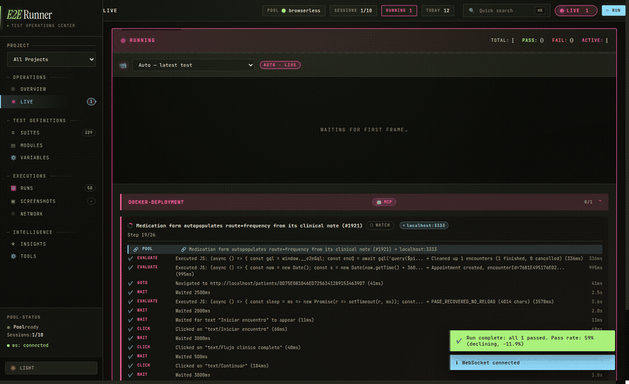
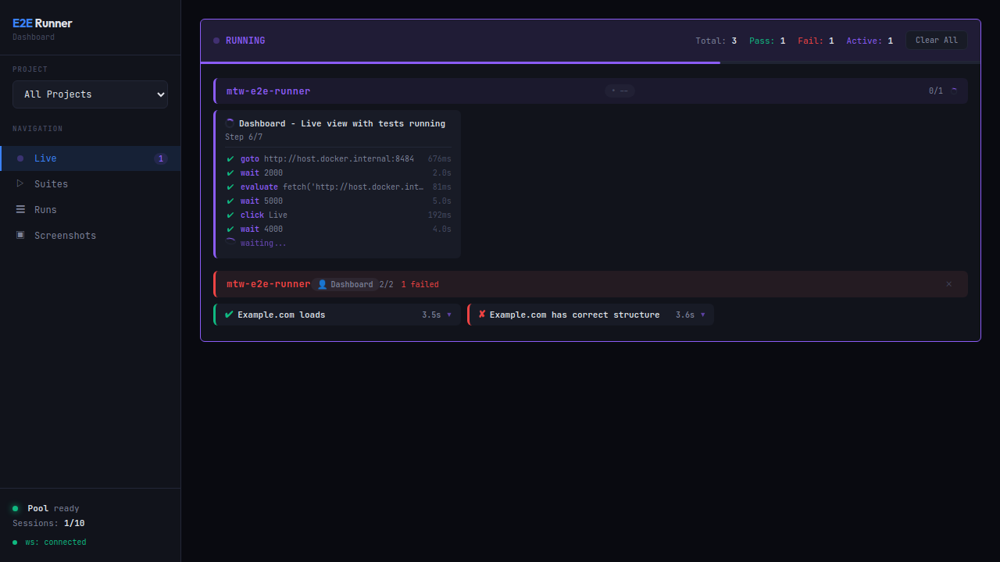
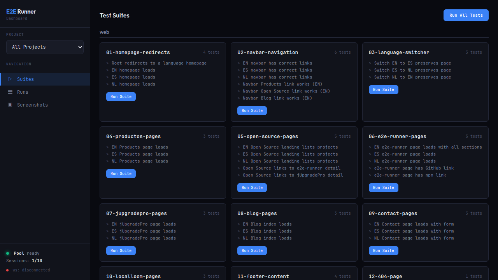
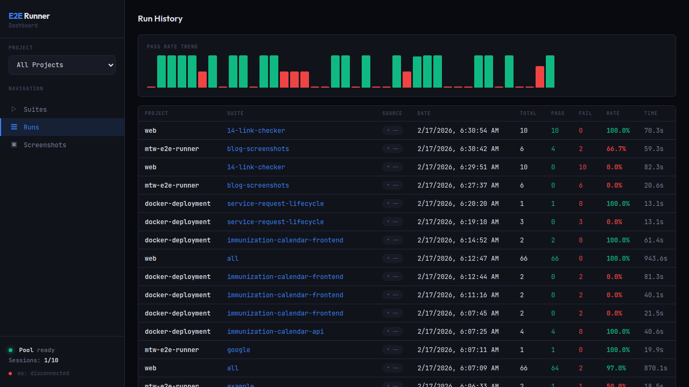
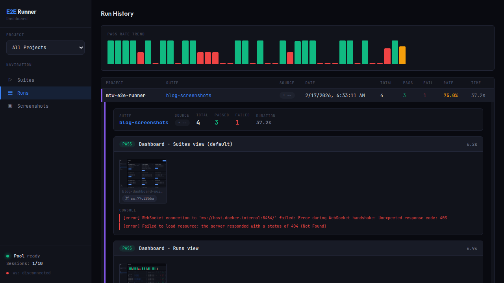
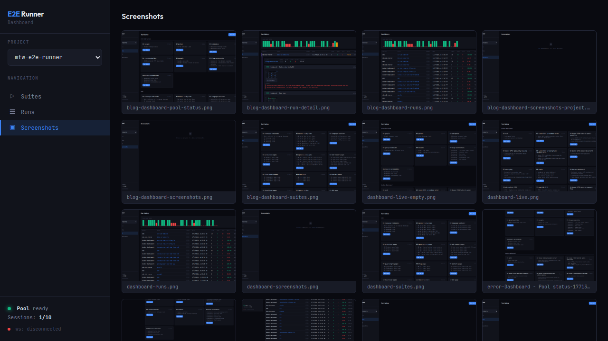
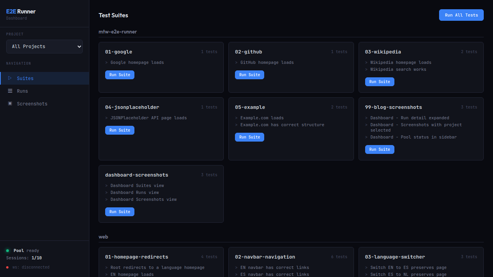

<p align="right">
  <strong>English</strong> · <a href="LEEME.md">Español</a>
</p>

<h1 align="center">@matware/e2e-runner</h1>

<p align="center">
  <strong>The AI-native E2E test runner that writes, runs, and debugs tests for you.</strong>
</p>

<p align="center">
  <a href="https://www.npmjs.com/package/@matware/e2e-runner"></a>
  
  <a href="https://www.npmjs.com/package/@matware/e2e-runner"></a>
  <a href="https://hub.docker.com/r/fastslack/e2e-runner-mcp"></a>
  <a href="https://github.com/fastslack/mtw-e2e-runner/stargazers"></a>
  <a href="LICENSE"></a>
  
  
  
  <a href="https://skills.sh"></a>
</p>

---

**E2E Runner** lets you test your web app without writing test code. Tests are plain JSON — and you don't even have to write that yourself: **just ask Claude Code.**

## 🎬 Write a test by asking — then watch it run

<p align="center">
  
  <br/><sub><em>The live dashboard while a suite runs — every step streams a screenshot into the feed, in real time.</em></sub>
</p>

With the built-in [MCP server](https://modelcontextprotocol.io/), creating a test is a conversation — no docs, no syntax to memorize:

> **You:** *Create an E2E test for the login flow and run it.*
>
> **Claude Code:** *writes the test, runs it in a real browser, and reports back —*
> ✅ `login-flow` passed in 2.3s · screenshot saved · no network errors.

Behind the scenes Claude just wrote and ran this. A test is **just JSON** — an ordered list of what a user does:

```json
[
  { "name": "login-flow", "actions": [
    { "type": "goto", "value": "/login" },
    { "type": "type", "selector": "#email", "value": "user@test.com" },
    { "type": "type", "selector": "#password", "value": "secret" },
    { "type": "click", "text": "Sign In" },
    { "type": "assert_text", "text": "Welcome back" },
    { "type": "screenshot", "value": "logged-in.png" }
  ]}
]
```

No imports, no `describe`/`it`, no build step. If you can read it you can write it — or just ask.

**Connect it to Claude Code (2 commands):**

```bash
claude plugin marketplace add fastslack/mtw-e2e-runner
claude plugin install e2e-runner@matware
```

Now say *"create a test for X and run it"* — Claude gets 17 MCP tools, slash commands, and specialized agents.

> Using a different agent (Cursor, Codex, Copilot, [40+ more](https://github.com/vercel-labs/skills#supported-agents))? Install the skill: `npx -y skills@1.9.0 add fastslack/mtw-e2e-runner`

---

## 📖 Contents

|   | Section | What's inside |
|---|---------|---------------|
| 🚀 | **[Install &amp; first test](#install)** | npm setup · run with your own Chrome (no Docker), Obscura, or a Docker pool |
| ✨ | **[What you get](#features)** | feature overview at a glance |
| ✍️ | **[Writing tests](#writing-tests)** | test format · full action catalog · retries · serial · modules · auth · hooks |
| 🤖 | **[AI integration](#ai)** | Claude Code · OpenCode · 17 MCP tools · visual verification · issue-to-test |
| 📊 | **[Dashboard &amp; insights](#dashboard)** | live dashboard · learning system · network logs · screenshot capture |
| 🌐 | **[Browser drivers](#drivers)** | browserless · cdp · lightpanda · obscura · moli · steel |
| ⚙️ | **[CLI, config &amp; CI](#reference)** | commands · flags · `e2e.config.js` · GitHub Actions · programmatic API |

---

<a name="install"></a>

## 🚀 Install — it's tiny

```bash
npm install --save-dev @matware/e2e-runner@1.6.0
npx -y @matware/e2e-runner@1.6.0 init        # scaffolds e2e/ with a sample test + config
```

Then pick how to run the browser. **You don't need Docker** unless you want the parallel pool:

### Option 1 · Use the Chrome you already have — no Docker ⭐

Launch any Chromium browser with a debugging port, then point the runner at it:

```bash
google-chrome --headless=new --remote-debugging-port=9222 &   # or brave / chromium / msedge
CHROME_POOL_URL=http://localhost:9222 POOL_DRIVER=cdp npx -y @matware/e2e-runner@1.6.0 run --all
```

Or bake it into `e2e.config.js` so you never repeat it:

```js
export default {
  baseUrl: 'http://localhost:3000',     // your app — plain localhost, no docker hostname
  poolUrls: ['http://localhost:9222'],
  poolDriver: 'cdp',
};
```

Nothing to install beyond npm, and `baseUrl` is just `localhost` (the browser is on your machine).

### Option 2 · Obscura — one tiny binary, no Docker

A single ~30 MB binary with built-in anti-detection. Install once, run it, point the runner at it:

```bash
obscura serve --port 9222 --stealth &
CHROME_POOL_URL=http://localhost:9222 POOL_DRIVER=obscura npx -y @matware/e2e-runner@1.6.0 run --all
```

`npx -y @matware/e2e-runner@1.6.0 pool start` (with `poolDriver: 'obscura'` in your config) prints the exact install command for your OS.

### Option 3 · Docker pool — parallel, for CI &amp; big suites

A shared, queue-managed Chrome pool that runs many tests at once:

```bash
npx -y @matware/e2e-runner@1.6.0 run --all     # the first run auto-starts the Docker pool for you
```

Requires Docker. Set `baseUrl: 'http://host.docker.internal:3000'` so the containerized Chrome can reach your app.

<details>
<summary><strong>Why <code>host.docker.internal</code> (Docker option only)?</strong></summary>

<br/>

With the Docker pool, Chrome runs inside a container, so `localhost` there means the container — not your machine. `host.docker.internal` bridges to your host. On Linux (Docker Engine, not Docker Desktop) add `--add-host=host.docker.internal:host-gateway`, or use your LAN IP. Options 1 &amp; 2 don't have this — the browser is local, so plain `localhost` just works.

</details>

### Write your first test

Open `e2e/tests/sample.json` — a flow is an ordered list of actions:

```json
[
  { "name": "homepage loads", "actions": [
    { "type": "goto", "value": "/" },
    { "type": "assert_text", "text": "Welcome" },
    { "type": "screenshot", "value": "home.png" }
  ]}
]
```

Run it with `npx -y @matware/e2e-runner@1.6.0 run --all`. Results — pass/fail, timing, screenshots, network errors — print to your terminal and to the [web dashboard](#dashboard) if it's open.

<details>
<summary><strong>Add OpenCode</strong> (optional)</summary>

<br/>

```bash
cp node_modules/@matware/e2e-runner/opencode.json ./
mkdir -p .opencode && cp -r node_modules/@matware/e2e-runner/.opencode/* .opencode/
```

See [OPENCODE.md](OPENCODE.md) for details.

</details>

### Updating

Each install method updates separately — bump the one(s) you use:

```bash
# npm dependency (per project)
npm install --save-dev @matware/e2e-runner@1.6.0

# Claude Code plugin
claude plugin update e2e-runner@matware

# MCP-only install (pinned to an exact version — bump it to upgrade)
claude mcp add --transport stdio --scope user e2e-runner \
  -- npx -y -p @matware/e2e-runner@1.6.0 e2e-runner-mcp
```

> [!NOTE]
> Two gotchas: **(1)** `npx` prefers a copy found in the project's `node_modules` over its own cache — if a project pins an old version, the MCP server and dashboard run that old version, so update the project dependency too. **(2)** Already-running processes keep the old code in memory: after updating, restart the dashboard and reconnect the MCP server (`/mcp` → `e2e-runner` → Reconnect, or restart your session).

---

<a name="features"></a>

## ✨ What you get

🧪 **Zero-code tests** — JSON files that anyone on your team can read and write. No JavaScript, no compilation, no framework lock-in.

🤖 **AI-powered testing** — Claude Code creates, executes, and debugs tests natively through 17 MCP tools. Ask it to "test the checkout flow" and it builds the JSON, runs it, and reports back.

🐛 **Issue-to-Test pipeline** — Paste a GitHub or GitLab issue URL. The runner fetches it, generates E2E tests, runs them, and tells you: *bug confirmed* or *not reproducible*.

👁️ **Visual verification** — Describe what the page should look like in plain English. The AI captures a screenshot and judges pass/fail against your description. No pixel-diffing setup needed.

🧠 **Learning system** — Tracks test stability across runs. Detects flaky tests, unstable selectors, slow APIs, and error patterns — then surfaces actionable insights.

⚡ **Parallel execution** — Run N tests simultaneously against a shared browser pool (browserless, raw CDP, Lightpanda, Obscura, Moli, or Steel). Serial mode available for tests that share state.

🎯 **Pluggable browser drivers** — Pick the engine that fits each test: real Chrome via browserless, Lightpanda, Obscura or Moli for fast lightweight runs, Steel for managed sessions. Set `driver` per test or override the whole run with `--driver`.

📊 **Real-time dashboard** — Live execution view, run history with pass-rate charts, screenshot gallery with hash-based search, expandable network request logs.

🔁 **Smart retries** — Test-level and action-level retries with configurable delays. Flaky tests are detected and flagged automatically.

📦 **Reusable modules** — Extract common flows (login, navigation, setup) into parameterized modules and reference them with `$use`.

🏗️ **CI-ready** — JUnit XML output, exit code 1 on failure, auto-captured error screenshots. Drop-in GitHub Actions example included.

🌐 **Multi-project** — One dashboard aggregates test results from all your projects. One Chrome pool serves them all.

🐳 **Portable** — Chrome runs in Docker, tests are JSON files in your repo. Works on any machine with Node.js and Docker.

---

<a name="writing-tests"></a>

## ✍️ Writing tests

Everything about authoring tests — the file format, the full action vocabulary, retries, state isolation, and reuse. Expand what you need:

<details>
<summary><strong>Test format &amp; file layout</strong></summary>

<br/>

Each `.json` file in `e2e/tests/` contains an array of tests. Each test has a `name` and sequential `actions`:

```json
[
  {
    "name": "homepage-loads",
    "actions": [
      { "type": "goto", "value": "/" },
      { "type": "assert_visible", "selector": "body" },
      { "type": "assert_url", "value": "/" },
      { "type": "screenshot", "value": "homepage.png" }
    ]
  }
]
```

Suite files can have numeric prefixes for ordering (`01-auth.json`, `02-dashboard.json`). The `--suite` flag matches with or without the prefix, so `--suite auth` finds `01-auth.json`.

</details>

<details>
<summary><strong>Action catalog</strong> — navigation, input &amp; interaction</summary>

<br/>

| Action | Fields | Description |
|--------|--------|-------------|
| `goto` | `value` | Navigate to URL (relative to `baseUrl` or absolute) |
| `click` | `selector` or `text` | Click by CSS selector or visible text content. Text mode also takes `scope: "dialog"`, `visible: true`, `last: true` |
| `type` / `fill` | `selector`, `value` | Clear field and type text |
| `wait` | `selector`, `text`, `gone`, or `value` (ms) | Wait for element/text to appear, for `gone` to disappear (spinner/dialog), or fixed delay. Prefer conditions over fixed `value` sleeps |
| `screenshot` | `value` (filename) | Capture a screenshot |
| `select` | `selector`, `value` | Select a dropdown option |
| `clear` | `selector` | Clear an input field |
| `press` | `value` | Press a keyboard key (`Enter`, `Tab`, etc.) |
| `scroll` | `selector` or `value` (px) | Scroll to element or by pixel amount |
| `hover` | `selector` | Hover over an element |
| `evaluate` | `value` | Execute JavaScript in the browser context |
| `navigate` | `value` | Browser navigation (`back`, `forward`, `reload`) |
| `clear_cookies` | — | Clear all cookies for the current page |
| `wait_network_idle` | optional `value` (idle ms, default 500), `timeout` | Wait until the network has been idle for `value` ms — useful after actions that trigger background requests |
| `set_storage` | `value` (`"key=val"`), optional `selector: "session"` | Set a `localStorage` key (or `sessionStorage` with `selector: "session"`) |
| `gql` | `value` (query), optional `text` (variables JSON), optional `selector` (assertion) | Run a GraphQL query/mutation via in-page `fetch`, with the auth token read from `localStorage`. Fails on GraphQL errors. `selector` is a JS expression asserted against the response `r` (e.g. `"r.data.users.length > 0"`). Installs `window.__e2eGql` for later `evaluate` steps |

**Click by text** — when `click` uses `text` instead of `selector`, it searches across common interactive and content elements:

```
button, a, [role="button"], [role="tab"], [role="menuitem"], [role="option"],
[role="listitem"], div[class*="cursor"], span, li, td, th, label, p, h1-h6
```

```json
{ "type": "click", "text": "Sign In" }
```

</details>

<details>
<summary><strong>Assertions</strong> — verify text, elements, URLs, counts &amp; network</summary>

<br/>

| Action | Fields | Description |
|--------|--------|-------------|
| `assert_text` | `text` | Assert text exists anywhere on the page (substring) |
| `assert_no_text` | `text` | Assert text does NOT appear anywhere on the page — opposite of `assert_text` |
| `assert_text_in` | `selector`, `text`, optional `value: "exact"` | Assert text inside a scoped container. `text` is a case-insensitive regex by default; `value: "exact"` switches to case-sensitive substring |
| `assert_element_text` | `selector`, `text`, optional `value: "exact"` | Assert element's text contains (or exactly matches) the expected text |
| `assert_url` | `value` | Assert current URL path or full URL. Paths (`/dashboard`) compare against pathname only |
| `assert_visible` | `selector` | Assert element exists and is visible |
| `assert_not_visible` | `selector` | Assert element is hidden or doesn't exist |
| `assert_attribute` | `selector`, `value` | Check attribute: `"type=email"` for value, `"disabled"` for existence |
| `assert_class` | `selector`, `value` | Assert element has a CSS class |
| `assert_input_value` | `selector`, `value` | Assert input/select/textarea `.value` contains text |
| `assert_matches` | `selector`, `value` (regex) | Assert element text matches a regex pattern |
| `assert_count` | `selector`, `value` | Assert element count: exact (`"5"`), or operators (`">3"`, `">=1"`, `"<10"`) |
| `assert_no_network_errors` | — | Fail if any network requests failed (e.g. `ERR_CONNECTION_REFUSED`) |
| `assert_storage` | `value` (`"key"` or `"key=expected"`), optional `selector: "session"` | Assert a `localStorage`/`sessionStorage` key exists or has a specific value |
| `assert_visual` | `value` (golden image), optional `selector`, `text` (max diff, e.g. `"0.02"`), `fullPage`, `maskRegions`, `threshold` | Visual regression: compare a screenshot against a golden reference. The first run saves the golden; later runs fail if more pixels differ than the threshold (default 2%) and write a diff image |
| `get_text` | `selector` | Extract element text (non-assertion, never fails). Result: `{ value: "..." }` |

</details>

<details>
<summary><strong>Framework-aware actions</strong> — React/MUI without <code>evaluate</code> boilerplate</summary>

<br/>

These actions handle common patterns in React/MUI apps that normally require verbose `evaluate` boilerplate:

| Action | Fields | Description |
|--------|--------|-------------|
| `type_react` | `selector`, `value`, optional `blur`, `waitAfter` | Type into React controlled inputs using the native value setter. Dispatches `input` + `change` events so React state updates correctly. `blur: true` commits on blur; `waitAfter: "<ms>"` waits after (debounced autocomplete). |
| `click_regex` | `text` (regex), optional `selector`, optional `value: "last"` | Click element whose textContent matches a regex (case-insensitive). Default: first match. Use `value: "last"` for last match. |
| `click_option` | `text` | Click a `[role="option"]` element by text — common in autocomplete/select dropdowns. |
| `select_combobox` | `text`, optional `selector`, `filter`, `openWait`/`filterWait`/`waitAfter` | Open a MUI Autocomplete/Select, optionally type `filter`, then click the option matching `text`. Falls back across `[role="option"]`, `.MuiAutocomplete-option`, `li.MuiMenuItem-root`. |
| `focus_autocomplete` | `text` (label text) | Focus an autocomplete input by its label text. Supports MUI and generic `[role="combobox"]`. |
| `click_chip` | `text` | Click a chip/tag element by text. Searches `[class*="Chip"]`, `[class*="chip"]`, `[data-chip]`. |
| `click_icon` | `value` (icon id), optional `selector` (scope) | Click an icon by `data-testid`/`data-icon`/`aria-label`/class fragment or SVG `<title>` — MUI, FontAwesome, Heroicons, etc. Clicks the nearest clickable ancestor (button, link, tab). |
| `click_menu_item` | `text`, optional `selector` (scope) | Click a menu item by text across `[role="menuitem"]`, `.dropdown-item`, `.menu-item`, MUI `MenuItem`. |
| `click_in_context` | `text` (container text), `selector` (child) | Click a child element inside the smallest container matching `text` — e.g. the delete button of one specific card/row. |

```json
// Before: 5 lines of evaluate boilerplate
{ "type": "evaluate", "value": "const input = document.querySelector('#search'); const nativeSet = Object.getOwnPropertyDescriptor(window.HTMLInputElement.prototype, 'value').set; nativeSet.call(input, 'term'); input.dispatchEvent(new Event('input', {bubbles: true})); input.dispatchEvent(new Event('change', {bubbles: true}));" }

// After: 1 action
{ "type": "type_react", "selector": "#search", "value": "term" }
```

</details>

<details>
<summary><strong>Multi-tab actions</strong> — popups, OAuth windows &amp; cross-tab flows</summary>

<br/>

| Action | Fields | Description |
|--------|--------|-------------|
| `open_tab` | `value` (URL), optional `text` (label) | Open a new tab and navigate to the URL (relative to `baseUrl` or absolute). Label defaults to `tab-<n>` |
| `switch_tab` | `value` | Switch the active tab by label, numeric index, or title/URL match (regex or substring). `"default"` returns to the original tab |
| `wait_for_tab` | optional `text` (label), `timeout` | Wait for a new tab/popup opened by the app (`window.open`, `target="_blank"`) and make it the active tab |
| `assert_tab_count` | `value` | Assert the number of open tabs: exact (`"2"`) or operators (`">=2"`) |
| `close_tab` | optional `value` (label) | Close the current (or named) tab and switch back to the last remaining one |

All subsequent actions run in the active tab:

```json
{ "type": "click", "text": "Open report" }
{ "type": "wait_for_tab", "text": "report" }
{ "type": "assert_text", "text": "Quarterly results" }
{ "type": "close_tab" }
```

</details>

<details>
<summary><strong>Retries &amp; flaky detection</strong></summary>

<br/>

**Test-level retry** — retry an entire test on failure. Set globally via config or per-test:

```json
{ "name": "flaky-test", "retries": 3, "timeout": 15000, "actions": [...] }
```

Tests that pass after retry are flagged as **flaky** in the report and learning system.

**Action-level retry** — retry a single action without rerunning the entire test. Useful for timing-sensitive clicks and waits:

```json
{ "type": "click", "selector": "#dynamic-btn", "retries": 3 }
{ "type": "wait", "selector": ".lazy-loaded", "retries": 2 }
```

Set globally: `actionRetries` in config, `--action-retries <n>` CLI, or `ACTION_RETRIES` env var. Delay between retries: `actionRetryDelay` (default 500ms).

</details>

<details>
<summary><strong>Serial tests</strong> — for tests that share state</summary>

<br/>

Tests that share state (e.g., two tests modifying the same record) can race when running in parallel. Mark them as serial:

```json
{ "name": "create-patient", "serial": true, "actions": [...] }
{ "name": "verify-patient-list", "serial": true, "actions": [...] }
```

Serial tests run one at a time **after** all parallel tests finish — preventing interference without slowing down independent tests.

</details>

<details>
<summary><strong>Testing authenticated apps</strong></summary>

<br/>

The simplest approach — log in via the UI like a real user:

```json
{
  "hooks": {
    "beforeEach": [
      { "type": "goto", "value": "/login" },
      { "type": "type", "selector": "#email", "value": "test@example.com" },
      { "type": "type", "selector": "#password", "value": "test-password" },
      { "type": "click", "text": "Sign In" },
      { "type": "wait", "selector": ".dashboard" }
    ]
  },
  "tests": [...]
}
```

For SPAs with JWT, skip the login form by injecting the token directly:

```json
{ "type": "set_storage", "value": "accessToken=eyJhbGciOiJIUzI1NiIs..." }
```

Or set it globally in config:

```js
// e2e.config.js
export default {
  authToken: 'eyJhbGciOiJIUzI1NiIs...',
  authStorageKey: 'accessToken',
};
```

Each test runs in a **fresh browser context**, so auth state is automatically clean between tests.

> **More strategies:** Cookie-based auth, HTTP header injection, OAuth/SSO bypasses, reusable auth modules, and role-based testing — see [docs/authentication.md](docs/authentication.md)

</details>

<details>
<summary><strong>Reusable modules</strong> — extract common flows with <code>$use</code></summary>

<br/>

Extract common flows into parameterized modules:

```json
// e2e/modules/login.json
{
  "$module": "login",
  "description": "Log in via the UI login form",
  "params": {
    "email": { "required": true, "description": "User email" },
    "password": { "required": true, "description": "User password" }
  },
  "actions": [
    { "type": "goto", "value": "/login" },
    { "type": "type", "selector": "#email", "value": "{{email}}" },
    { "type": "type", "selector": "#password", "value": "{{password}}" },
    { "type": "click", "text": "Sign In" },
    { "type": "wait", "value": "2000" }
  ]
}
```

Use in tests:

```json
{
  "name": "dashboard-loads",
  "actions": [
    { "$use": "login", "params": { "email": "user@test.com", "password": "secret" } },
    { "type": "assert_text", "text": "Dashboard" }
  ]
}
```

Modules support parameter validation (required params fail fast), conditional blocks (`{{#param}}...{{/param}}`), nested composition, and cycle detection.

</details>

<details>
<summary><strong>Hooks</strong> — beforeAll / beforeEach / afterEach / afterAll</summary>

<br/>

Run actions at lifecycle points. Define globally in config or per-suite:

```json
{
  "hooks": {
    "beforeAll": [{ "type": "goto", "value": "/setup" }],
    "beforeEach": [{ "type": "goto", "value": "/" }],
    "afterEach": [{ "type": "screenshot", "value": "after.png" }],
    "afterAll": []
  },
  "tests": [...]
}
```

> **Important:** `beforeAll` runs on a separate browser page that is closed before tests start. Use `beforeEach` for state that tests need (cookies, localStorage, auth tokens).

</details>

<details>
<summary><strong>Exclude patterns</strong> — skip drafts from <code>--all</code></summary>

<br/>

Skip exploratory or draft tests from `--all` runs:

```js
// e2e.config.js
export default {
  exclude: ['explore-*', 'debug-*', 'draft-*'],
};
```

Individual suite runs (`--suite`) are not affected by exclude patterns.

</details>

---

<a name="ai"></a>

## 🤖 AI integration

The whole point: your agent writes, runs, and verifies tests for you.

<details>
<summary><strong>Claude Code</strong> — plugin install &amp; MCP-only install</summary>

<br/>

```bash
claude plugin marketplace add fastslack/mtw-e2e-runner
claude plugin install e2e-runner@matware
```

This gives Claude 17 MCP tools, a workflow skill, 4 slash commands (`/e2e-runner:run`, `/e2e-runner:create-test`, `/e2e-runner:verify-issue`, `/e2e-runner:capture`), and 3 specialized agents (test-analyzer, test-creator, test-improver).

**MCP-only install** (tools only, no skill/commands/agents):

```bash
claude mcp add --transport stdio --scope user e2e-runner \
  -- npx -y -p @matware/e2e-runner@1.6.0 e2e-runner-mcp
```

</details>

<details>
<summary><strong>OpenCode</strong></summary>

<br/>

```bash
cp node_modules/@matware/e2e-runner/opencode.json ./
mkdir -p .opencode && cp -r node_modules/@matware/e2e-runner/.opencode/* .opencode/
```

See [OPENCODE.md](OPENCODE.md) for details.

</details>

<details>
<summary><strong>The 17 MCP tools</strong></summary>

<br/>

| Tool | Description |
|------|-------------|
| `e2e_run` | Run tests (all, by suite, or by file) |
| `e2e_list` | List available test suites |
| `e2e_create_test` | Create a new test JSON file |
| `e2e_create_module` | Create a reusable module |
| `e2e_pool_status` | Check Chrome pool health |
| `e2e_app_pool_status` | Inspect the app environment pool (forks, ports, drivers) |
| `e2e_screenshot` | Retrieve a screenshot by hash |
| `e2e_capture` | Capture screenshot of any URL |
| `e2e_analyze` | Extract page structure (interactive elements, forms, headings) and emit test scaffolds |
| `e2e_dashboard_start` | Start web dashboard |
| `e2e_dashboard_stop` | Stop web dashboard |
| `e2e_dashboard_restart` | Restart the dashboard (new project dir/port, clear stale sessions) |
| `e2e_issue` | Fetch issue and generate tests |
| `e2e_network_logs` | Query network logs for a run |
| `e2e_learnings` | Query stability insights |
| `e2e_vars` | Manage SQLite-backed `{{var.KEY}}` project variables |
| `e2e_neo4j` | Manage Neo4j knowledge graph |

> Pool start/stop are CLI-only — not exposed via MCP.

</details>

<details>
<summary><strong>Visual verification</strong> — describe the page, AI judges it</summary>

<br/>

Describe what the page should look like — AI judges pass/fail from screenshots:

```json
{
  "name": "dashboard-loads",
  "expect": "Patient list with at least 3 rows, no error messages, sidebar with navigation links",
  "actions": [
    { "type": "goto", "value": "/dashboard" },
    { "type": "wait", "selector": ".patient-list" }
  ]
}
```

After test actions complete, the runner auto-captures a verification screenshot. The MCP response includes the screenshot hash — Claude Code retrieves it and visually verifies against your `expect` description. No API key required.

</details>

<details>
<summary><strong>Issue-to-test</strong> — turn a bug report into a runnable test</summary>

<br/>

Turn GitHub and GitLab issues into executable E2E tests. Paste an issue URL and get runnable tests — automatically.

**How it works:**

1. **Fetch** — Pulls issue details (title, body, labels) via `gh` or `glab` CLI
2. **Generate** — AI creates JSON test actions based on the issue description
3. **Run** — Optionally executes the tests immediately to verify if a bug is reproducible

```bash
# Fetch and display
e2e-runner issue https://github.com/owner/repo/issues/42

# Generate a test file via Claude API
e2e-runner issue https://github.com/owner/repo/issues/42 --generate

# Generate + run + report
e2e-runner issue https://github.com/owner/repo/issues/42 --verify
# -> "BUG CONFIRMED" or "NOT REPRODUCIBLE"
```

In Claude Code, just ask:
> "Fetch issue #42 and create E2E tests for it"

**Bug verification logic:** Generated tests assert the **correct** behavior. Test failure = bug confirmed. All tests pass = not reproducible.

**Auth:** GitHub requires `gh` CLI, GitLab requires `glab` CLI. Self-hosted GitLab is supported.

</details>

---

<a name="dashboard"></a>

## 📊 Dashboard &amp; insights

```bash
e2e-runner dashboard                  # Start on default port 8484
e2e-runner dashboard --port 9090      # Custom port
```

<details>
<summary><strong>Web dashboard tour</strong> — live view, history, gallery, pool status</summary>

<br/>

**Live execution** — monitor tests in real-time with step-by-step progress, durations, and active worker count.

<p align="center">
  
</p>

**Test suites** — browse all suites across projects. Run a single suite or all tests with one click.

<p align="center">
  
</p>

**Run history** — track pass-rate trends with the built-in chart. Click any row to expand full detail.

<p align="center">
  
</p>

**Run detail** — PASS/FAIL badges, screenshot thumbnails with copyable hashes (`ss:77c28b5a`), formatted console errors, and network request logs.

<p align="center">
  
</p>

**Screenshot gallery** — browse all captured screenshots with hash search (action, error, and verification captures).

<p align="center">
  
</p>

**Pool status** — Chrome pool health: available slots, running sessions, memory pressure.

<p align="center">
  
</p>

</details>

<details>
<summary><strong>Learning system</strong> — flaky tests, unstable selectors, slow APIs</summary>

<br/>

The runner learns from every test run — building knowledge about your test suite over time. Query insights via the `e2e_learnings` MCP tool:

| Query | Returns |
|-------|---------|
| `summary` | Full health overview: pass rate, flaky tests, unstable selectors, API issues |
| `flaky` | Tests that pass only after retries |
| `selectors` | CSS selectors with high failure rates |
| `pages` | Pages with console errors, network failures, load time issues |
| `apis` | API endpoints with error rates and latency (auto-normalized: UUIDs, hashes, IDs) |
| `errors` | Most frequent error patterns, categorized |
| `trends` | Pass rate over time (auto-switches to hourly when all data is from one day) |
| `test:<name>` | Drill-down history for a specific test |
| `page:<path>` | Drill-down history for a specific page |
| `selector:<value>` | Drill-down history for a specific selector |

**Storage &amp; export:**
- SQLite (`~/.e2e-runner/dashboard.db`) — default, zero setup
- Neo4j knowledge graph — optional, for relationship-based analysis. Manage via `e2e_neo4j` MCP tool or `docker compose`
- Markdown report (`e2e/learnings.md`) — auto-generated after each run

**Test narration:** Each test run generates a human-readable narrative of what happened step by step, visible in the CLI output and the dashboard.

</details>

<details>
<summary><strong>Network error handling</strong> — assertions, global flag, full logging</summary>

<br/>

**Explicit assertion** — place `assert_no_network_errors` after critical page loads:

```json
{ "type": "goto", "value": "/dashboard" },
{ "type": "wait", "selector": ".loaded" },
{ "type": "assert_no_network_errors" }
```

**Global flag** — set `failOnNetworkError: true` to automatically fail any test with network errors:

```bash
e2e-runner run --all --fail-on-network-error
```

When disabled (default), the runner still collects and reports network errors — the MCP response includes a warning when tests pass but have network errors.

**Full network logging** — all XHR/fetch requests are captured with URL, method, status, duration, request/response headers, and response body (truncated at 50KB). Viewable in the dashboard with expandable request detail rows.

MCP drill-down flow:

```
1. e2e_run          → compact networkSummary + runDbId
2. e2e_network_logs(runDbId)                     → all requests (url, method, status, duration)
3. e2e_network_logs(runDbId, errorsOnly: true)   → only failed requests
4. e2e_network_logs(runDbId, includeHeaders: true) → with headers
5. e2e_network_logs(runDbId, includeBodies: true)  → full request/response bodies
```

The `e2e_run` response stays compact (~5KB) regardless of how many requests were captured. Use `e2e_network_logs` with the returned `runDbId` to drill into details on demand.

</details>

<details>
<summary><strong>Screenshot capture</strong> — snapshot any URL on demand</summary>

<br/>

Capture screenshots of any URL on demand — no test suite required:

```bash
e2e-runner capture https://example.com
e2e-runner capture https://example.com --full-page --selector ".loaded" --delay 2000
```

Via MCP, the `e2e_capture` tool supports `authToken` and `authStorageKey` for authenticated pages — it injects the token into localStorage before navigating.

Every screenshot gets a deterministic hash (`ss:a3f2b1c9`). Use `e2e_screenshot` to retrieve any screenshot by hash — it returns the image with metadata (test name, step, type).

</details>

---

<a name="drivers"></a>

## 🌐 Browser drivers

The runner can talk to multiple browser engines through different drivers. The default is **`auto`** — it probes each pool URL and picks the right driver per pool.

| Driver | Engine | Detection probe | When to use |
|--------|--------|-----------------|-------------|
| `browserless` | Real Chromium via [browserless](https://www.browserless.io/) | `/pressure` returns JSON | Default. Production-grade JS execution, screencast, full Chrome behavior |
| `cdp` | Generic CDP-compatible (raw Chrome, etc.) | `/json/version` reachable | Fallback for any CDP server that isn't one of the others |
| `lightpanda` | [Lightpanda](https://lightpanda.io) (Zig) | `/json/version` Browser=lightpanda | ~9× faster, ~16× less memory than headless Chrome — ideal for high-volume scrape-style tests |
| `obscura` | [Obscura](https://github.com/h4ckf0r0day/obscura) (Rust + V8) | `/json/version` Browser=obscura | ~30 MB RAM footprint, built-in anti-detection (`--stealth`), stays close to real Chrome via Puppeteer |
| `moli` | [Moli](https://github.com/lexmount/moli) (Rust + V8) | `/json/version` has `Moli-Version` | Lightweight, structure-first engine with on-demand layout; real screenshots, `assert_visual` and screencast. **Requires `moli serve --layout`** — the runner fails fast with a fix hint otherwise |
| `steel` | [Steel Browser](https://steel.dev) | `/v1/sessions` returns JSON | Managed session lifecycle, REST API for orchestration |

<details>
<summary><strong>Pick a driver per test / force one per run</strong></summary>

<br/>

```json
{
  "tests": [
    {
      "name": "checkout flow (heavy JS, real Chrome)",
      "driver": "browserless",
      "actions": [...]
    },
    {
      "name": "scrape product page (lightweight)",
      "driver": "obscura",
      "fallbackDriver": "cdp",
      "actions": [...]
    }
  ]
}
```

`driver` is optional. If set, only pools whose detected driver matches become candidates. `fallbackDriver` is **explicit opt-in** — without it, a missing target driver fails the test with a clear message. Pool busyness does **not** trigger fallback; the runner waits inside the filtered set.

Force a driver for a whole run (CLI overrides win over per-test fields — useful for A/B benchmarks):

```bash
e2e-runner run --all --driver obscura
e2e-runner run --all --driver obscura --fallback-driver cdp
```

</details>

<details>
<summary><strong>Running each driver locally</strong></summary>

<br/>

```bash
# browserless (default) — managed by `pool start`
e2e-runner pool start

# Lightpanda — pool start uses templates/docker-compose-lightpanda.yml
e2e-runner pool start                 # with poolDriver: 'lightpanda' in config

# Obscura — install the binary and run it yourself
curl -LO https://github.com/h4ckf0r0day/obscura/releases/latest/download/obscura-x86_64-linux.tar.gz
tar xzf obscura-x86_64-linux.tar.gz
./obscura serve --port 9222 --stealth
# then point the runner at it: poolUrls: ['http://localhost:9222'], poolDriver: 'obscura'

# Moli — install the binary and run it with layout enabled (needed for clicks + screenshots)
curl --proto '=https' --tlsv1.2 -fsSL https://github.com/lexmount/moli/releases/latest/download/moli-installer.sh | sh
moli serve --layout --resource --port 9222
# then: poolUrls: ['http://localhost:9222'], poolDriver: 'moli' (or 'auto')
# Moli runs on the host, so use a host-reachable baseUrl (http://localhost:3000), not host.docker.internal
```

</details>

---

<a name="reference"></a>

## ⚙️ CLI, config &amp; CI

<details>
<summary><strong>CLI commands</strong></summary>

<br/>

```bash
# Run tests
e2e-runner run --all                  # All suites
e2e-runner run --suite auth           # Single suite
e2e-runner run --tests path/to.json   # Specific file
e2e-runner run --inline '<json>'      # Inline JSON

# Pool management (CLI only, not MCP)
e2e-runner pool start                 # Start Chrome container
e2e-runner pool stop                  # Stop Chrome container
e2e-runner pool status                # Check pool health

# Issue-to-test
e2e-runner issue <url>                # Fetch issue
e2e-runner issue <url> --generate     # Generate test via AI
e2e-runner issue <url> --verify       # Generate + run + report

# Dashboard
e2e-runner dashboard                  # Start web dashboard

# Other
e2e-runner list                       # List available suites
e2e-runner capture <url>              # On-demand screenshot
e2e-runner init                       # Scaffold project
```

</details>

<details>
<summary><strong>CLI options</strong></summary>

<br/>

| Flag | Default | Description |
|------|---------|-------------|
| `--base-url <url>` | `http://host.docker.internal:3000` | Application base URL |
| `--pool-url <ws>` | `ws://localhost:3333` | Chrome pool WebSocket URL |
| `--concurrency <n>` | `3` | Parallel test workers |
| `--retries <n>` | `0` | Retry failed tests N times |
| `--action-retries <n>` | `0` | Retry failed actions N times |
| `--test-timeout <ms>` | `60000` | Per-test timeout |
| `--timeout <ms>` | `10000` | Default action timeout |
| `--output <format>` | `json` | Report: `json`, `junit`, `both` |
| `--env <name>` | `default` | Environment profile |
| `--fail-on-network-error` | `false` | Fail tests with network errors |
| `--project-name <name>` | dir name | Project display name |
| `--driver <name>` | _(per-test)_ | Force pool driver for the run: `browserless`, `cdp`, `lightpanda`, `moli`, `obscura`, `steel` |
| `--fallback-driver <name>` | _none_ | Explicit fallback if no pool with `--driver` is reachable |

</details>

<details>
<summary><strong>Configuration</strong> — <code>e2e.config.js</code> &amp; priority</summary>

<br/>

Create `e2e.config.js` in your project root:

```js
export default {
  baseUrl: 'http://host.docker.internal:3000',
  concurrency: 4,
  retries: 2,
  actionRetries: 1,
  testTimeout: 30000,
  outputFormat: 'both',
  failOnNetworkError: true,
  exclude: ['explore-*', 'debug-*'],

  hooks: {
    beforeEach: [{ type: 'goto', value: '/' }],
  },

  environments: {
    staging: { baseUrl: 'https://staging.example.com' },
    production: { baseUrl: 'https://example.com', concurrency: 5 },
  },
};
```

**Config priority (highest wins):**

1. CLI flags
2. Environment variables
3. `.env` file in the project root (KEY=VALUE, never overrides existing `process.env` values)
4. Config file (`e2e.config.js` or `e2e.config.json`)
5. Defaults

When `--env <name>` is set, the matching profile overrides everything.

</details>

<details>
<summary><strong>CI/CD</strong> — JUnit XML &amp; GitHub Actions</summary>

<br/>

```bash
e2e-runner run --all --output junit
```

```yaml
jobs:
  e2e:
    runs-on: ubuntu-latest
    steps:
      - uses: actions/checkout@v4
      - uses: actions/setup-node@v4
        with:
          node-version: 20
      - run: npm ci
      - run: npx -y @matware/e2e-runner@1.6.0 pool start
      - run: npx -y @matware/e2e-runner@1.6.0 run --all --output junit
      - uses: mikepenz/action-junit-report@v4
        if: always()
        with:
          report_paths: e2e/screenshots/junit.xml
```

</details>

<details>
<summary><strong>Programmatic API</strong></summary>

<br/>

```js
import { createRunner } from '@matware/e2e-runner';

const runner = await createRunner({ baseUrl: 'http://localhost:3000' });

const report = await runner.runAll();
const report = await runner.runSuite('auth');
const report = await runner.runFile('e2e/tests/login.json');
const report = await runner.runTests([
  { name: 'quick-check', actions: [{ type: 'goto', value: '/' }] },
]);
```

**Embedding the runner in another program?** Use the stable, side-effect-free entry instead — versioned results (`schemaVersion: 1`, JSON Schema included), no dashboard DB / learnings / LLM calls, no native addons:

```js
import { runSuite, inspectPage } from '@matware/e2e-runner/embed';

const result = await runSuite(tests, { baseUrl, poolUrl, screenshotsDir, vars, env });
const page = await inspectPage('http://app:3000/login', { poolUrl, screenshotsDir });
```

See [docs/embedding.md](docs/embedding.md).

</details>

---

## Requirements

- **Node.js** >= 20
- **Docker** — only for [Option 3](#install) (the parallel Chrome pool). Options 1 &amp; 2 don't need it.

## License

Copyright 2026 Matias Aguirre (fastslack) — Matware

Licensed under the Apache License, Version 2.0. See [LICENSE](LICENSE) for details.
